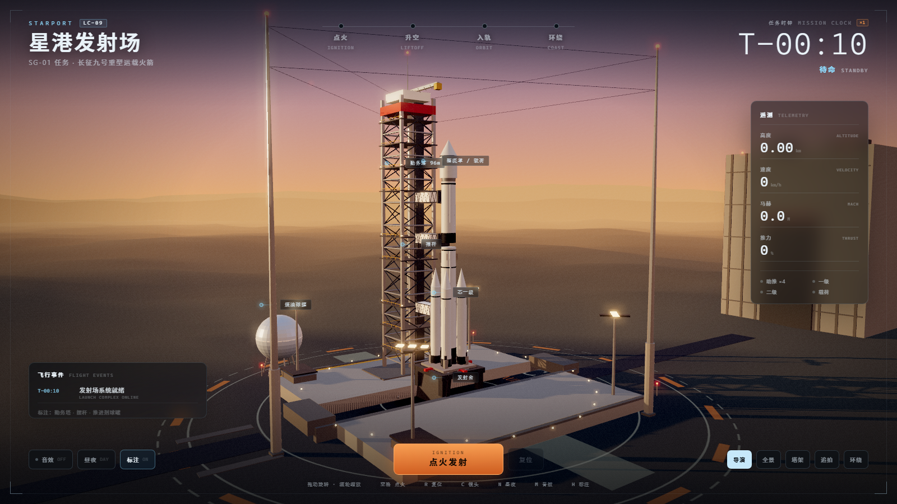
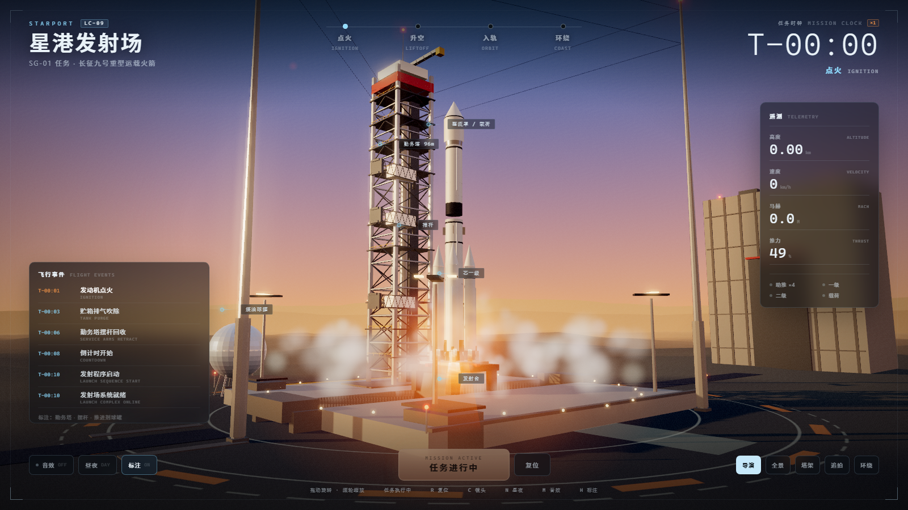
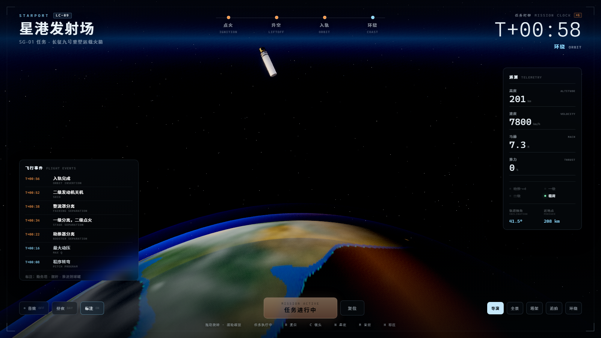
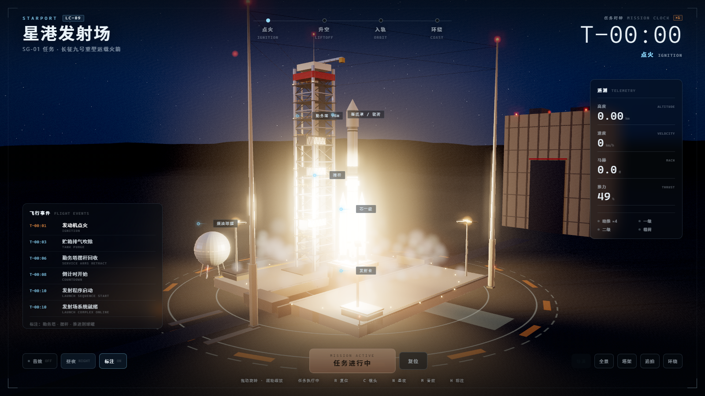

# 星港发射场 · Launch Complex 69

一个用 **Blender 5.2 建模**、**three.js 0.160 实时渲染**的火箭发射工位可交互 3D 沙盘。
从倒计时、点火、升空、助推器分离，到入轨、载荷释放、环绕地球，全过程可播放、可暂停观察、可自由拖拽视角。

**在线访问：** [https://159357248655qq-dot.github.io/starpad-lc09/](https://159357248655qq-dot.github.io/starpad-lc09/)

## 快速运行

项目不依赖构建工具，但 ES module 需要通过 HTTP 打开：

```bash
cd 星港发射场
python -m http.server 8779
# 浏览器打开 http://127.0.0.1:8779/
```

## 操作

| 操作 | 功能 |
| --- | --- |
| 鼠标拖拽 / 滚轮 | 旋转、缩放视角 |
| `空格` / 「点火发射」 | 开始任务 |
| `R` / 「复位」 | 回到待命状态 |
| `C` / 右下角机位按钮 | 导演、全景、塔架、追拍、环绕 |
| `N` / 「日间 / 夜间」 | 切换昼夜照明 |
| `M` / 「音效」 | 开关 WebAudio 音效 |
| `H` / 「标注」 | 显示/隐藏结构热点 |

## 任务阶段

T-10s 发射程序启动 → T-6s 摆杆回收 → T-3s 贮箱排气 → T-0 点火 → 升空 → 程序转弯 / 最大动压 → 助推器分离 → 一级分离、二级点火 → 整流星罩分离 → 二级关机 → 入轨 → 载荷释放、环绕地球。

## 技术栈

- **Blender 5.2**：`blender/build_complex.py` 程序化生成发射台、导流槽、勤务塔、摆杆、避雷塔、球罐、水塔、总装厂房、探照灯与道路；合并静态几何为 `assets/launch_complex.glb`（约 720 KB）。
- **three.js 0.160**（本地 `vendor/`，不依赖 CDN）。
- 后期：EffectComposer + HalfFloat MSAA RenderTarget、UnrealBloom、调色 ShaderPass、ACES Filmic、暗角/颗粒。
- 火箭：程序化两级半构型，助推器/一级/整流罩/载荷均可分离；多层尾焰 Shader、地面烟、导流槽火光、真空羽流。
- 地球：程序化海陆/海岸线/云层/大气壳 Shader；入轨后镜头拉远形成地球弧线。
- 天空：昼夜/太空渐变、星空、太阳/月亮方向光；PMREM 环境反射。
- 音效：全部用 WebAudio 实时合成（噪声风声、低频轰鸣、倒计时滴答、点火 boom、分离 clank、跨音速 sonic boom），无外部音频文件。
- HUD：任务时钟、遥测、飞行事件流、阶段进度、结构热点、镜头/昼夜/音效开关。

## 目录

```
index.html            入口
css/style.css         HUD 与玻璃面板样式
js/app.js             启动、时间线、导演镜头、后期、交互、调试 API
js/rocket.js          火箭几何、分离、尾焰、烟雾、点火光
js/world.js           天空、光照、雾、地面、云、星
js/earth.js           地球纹理与网格
js/shaders.js         天空/地球/尾焰/调色 GLSL
js/audio.js           WebAudio 合成音效
js/pad.js             发射场 GLB 加载与摆杆动画
js/timeline.js        任务时间线、遥测与事件
js/ui.js              HUD 更新、按钮、日志
blender/build_complex.py  Blender 程序化建模脚本
assets/launch_complex.glb 发射场模型
vendor/three@0.160.0      three.js 本地副本
previews/                最终预览图
```

## 截图





